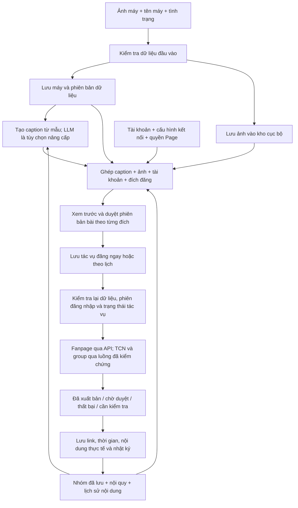

# Auto Post MKT — Ứng dụng hỗ trợ bán điện thoại trên Facebook

> Trạng thái: MVP nội bộ Windows đã có luồng quản lý máy, duyệt/xếp lịch, đăng nhóm/trang cá nhân và theo dõi kết quả. Một lần đăng thật mỗi kênh đã được ghi nhận; chưa nghiệm thu đầy đủ vận hành. Các phần dự kiến bên dưới cần đối chiếu `plan.md` và `report_daily.md` để biết trạng thái triển khai.
> Cập nhật: 28/10/2026. Hướng dẫn mới: [Quét nhóm đã tham gia và chọn số nhóm muốn đăng](docs/joined-groups.md).

Code và dữ liệu cùng nằm trong thư mục dự án: **`data/`** chứa DB, ảnh, hồ sơ đăng nhập, cache và backup; `local-backups/` giữ bản dự phòng khi chuyển từ AppData. Git bỏ qua cả hai thư mục. Xem [ADR 0012](docs/adr/0012-project-local-data.md).

## 1. Tổng quan bài toán

Người dùng bán nhiều dòng điện thoại và muốn giảm thời gian chuẩn bị, đăng và theo dõi bài bán hàng trên Facebook. Phạm vi sử dụng ban đầu là **một người vận hành, hai tài khoản Facebook**, đăng lên trang cá nhân (TCN), các group đã tham gia và fanpage được phép quản lý.

Những công việc cần giải quyết:

- Nhập máy bằng ảnh, tên máy và tình trạng; bổ sung giá hoặc thông tin quản lý hàng hóa khi có nhu cầu.
- Chuẩn bị nội dung đúng với từng máy và từng nơi đăng.
- Chọn tài khoản, nơi đăng và thời điểm đăng trong một giao diện.
- Theo dõi bài nào đã gửi, chờ duyệt, đã xuất bản hoặc gặp lỗi.
- Hạn chế đăng trùng, đăng hàng đã bán; dừng tác vụ khi phát hiện cảnh báo từ Facebook.
- Về sau, tích hợp API LLM để hỗ trợ viết caption theo từng nhóm khách hàng.

Mục tiêu là tiết kiệm thao tác và hỗ trợ bán hàng có kiểm soát. Số bài đăng không phải thước đo thành công duy nhất; cần quan tâm thời gian tiết kiệm, khách hỏi mua và đơn hàng thực tế.

## 2. Định hướng đã thống nhất

- **Tự phát triển từ đầu**, không kế thừa mã nguồn repo `dt135/auto-post`.
- Tập trung vào hai tài khoản Facebook; chưa xây hệ thống quản lý tài khoản số lượng lớn hoặc nền tảng bán phần mềm cho nhiều cửa hàng.
- Ưu tiên kiểm chứng khả năng đăng TCN/group trước khi đầu tư xây đầy đủ ứng dụng.
- Bản đầu tự tạo caption từ mẫu dựa trên tên máy và tình trạng, ghép với ảnh người dùng cung cấp; người dùng có thể chỉnh tay. LLM là phần nâng cấp sau; giá và các trường khác không bắt buộc để bắt đầu.
- Hướng sử dụng ban đầu: chạy trên máy Windows của người vận hành, có giao diện quản lý và dữ liệu lưu cục bộ.
- Các chức năng bên dưới là **dự kiến**, không phải tính năng đã hoạt động.

## 3. Cách tiếp cận giải pháp

### 3.1. Tách quản lý nội dung và thực hiện đăng

Ứng dụng quản lý tập trung sản phẩm, ảnh, bài viết, nơi đăng và lịch. Mỗi lần xuất bản tạo một tác vụ gắn với một tài khoản, một nơi đăng và một phiên bản nội dung cụ thể.

Phần thực hiện đăng được tách theo kênh:

| Kênh | Hướng triển khai dự kiến | Điểm cần kiểm chứng |
| --- | --- | --- |
| Fanpage | Dùng Facebook Graph API khi ứng dụng và người dùng có đủ quyền | Kết nối Page, quyền đăng, ảnh và trạng thái token |
| TCN của hai tài khoản | Thử nghiệm điều khiển trình duyệt đã được người dùng đăng nhập | Luồng đăng thực tế, phiên đăng nhập, nhận diện kết quả và yêu cầu xác minh |
| Group đã tham gia | Thử nghiệm thao tác qua trình duyệt bằng tài khoản có quyền đăng trong nhóm | Nội quy nhóm, quyền đăng, bài chờ duyệt và thay đổi giao diện |

TCN/group chưa có đường tích hợp API công khai phù hợp để coi là một kết nối được bảo đảm. Tự động hóa trình duyệt là hướng cần thử nghiệm, không phải cam kết đã khả thi hoặc chạy ổn định lâu dài.

Nếu thử nghiệm không đạt, phương án hỗ trợ là chuẩn bị bài, ảnh và nhắc người dùng hoàn tất đăng trên Facebook. Phương án này phải được ghi rõ là bán tự động; không coi là đã đáp ứng yêu cầu tự đăng hoàn toàn.

### 3.2. Giới hạn liên quan đến spam và tài khoản

- Hai tài khoản vẫn có thể bị hạn chế thao tác hoặc khóa; phần mềm không cam kết chống ban.
- Đã tham gia group không đồng nghĩa được phép đăng bán hàng hoặc được duyệt bài.
- Không có ngưỡng số bài/ngày được coi là chắc chắn an toàn cho mọi tài khoản và nhóm.
- Đổi caption, đặt thời gian chờ hoặc dùng AI không bảo đảm tránh bị xem là spam.
- Khi quan sát được cảnh báo, yêu cầu xác minh hoặc chặn thao tác, hệ thống phải dừng tác vụ liên quan để người dùng kiểm tra.
- Khả năng nhận diện cảnh báo qua giao diện phải được kiểm thử; chưa cam kết phát hiện mọi tình huống Facebook có thể đưa ra.

### 3.3. Bố cục giao diện: bốn mục chính

Giao diện tham khảo cách bố trí trong ảnh người dùng cung cấp: thanh điều hướng bên trái, vùng dữ liệu chính ở giữa và vùng cấu hình bên phải khi thực hiện tác vụ. Quy mô hai tài khoản cho phép bố cục gọn, ưu tiên trạng thái dễ hiểu và thao tác rõ ràng.

```text
Quản lý tài khoản
Quản lý proxy
Chức năng đăng bài                  [mở / thu gọn]
  ├─ Đăng bài viết nhóm
  ├─ Đăng bài viết cá nhân
  └─ Đăng bài fanpage
Quét nhóm
  ├─ Nhóm đã tham gia
  └─ Tìm nhóm theo từ khóa
```

Bốn mục trên là điều hướng chính của bản đầu. Sản phẩm, thư viện nội dung, mẫu bài và lịch sử là các trang phụ/ngăn trong khu vực đăng bài; có thể tách thành mục riêng khi phát sinh nhu cầu. Cấu hình LLM nằm trong phần cài đặt nâng cấp sau.

| Trang | Bố cục và thông tin chính | Thao tác chính |
| --- | --- | --- |
| Quản lý tài khoản | Thống kê trạng thái và bảng gồm chọn, tên nội bộ, UID/link nếu xác định được, tên Facebook, avatar, trạng thái phiên, proxy, lần kiểm tra, tác vụ hiện tại | Thêm tối đa hai tài khoản, mở trình duyệt để đăng nhập, kiểm tra phiên, sửa nhãn, gán proxy, tạm dừng, gỡ liên kết |
| Quản lý proxy | Bảng proxy và chi tiết gồm nhãn, giao thức, máy chủ/cổng, tài khoản được gán, trạng thái kiểm tra, IP đầu ra quan sát được, độ trễ, lần kiểm tra gần nhất | Thêm/sửa/xóa cấu hình, kiểm tra kết nối, gán hoặc bỏ gán tài khoản |
| Đăng bài viết nhóm | Chọn tài khoản và danh sách group ở vùng chính; cấu hình nội dung, ảnh và lịch ở vùng bên cạnh; kết quả chạy ở phía dưới | Nhận group từ trang Quét nhóm hoặc nhập link/ID, chọn bài, xem trước, bắt đầu, tạm dừng, dừng |
| Đăng bài viết cá nhân | Chọn một hoặc cả hai tài khoản, xác nhận đúng TCN đích; cấu hình nội dung và lịch | Xem trước theo tài khoản, đăng ngay/đặt lịch, theo dõi kết quả từng TCN |
| Đăng bài fanpage | Danh sách Page được cấp quyền, trạng thái kết nối và cấu hình bài viết | Kết nối Page, chọn một/nhiều Page, đăng ngay/đặt lịch, theo dõi kết quả từng Page |
| Quét nhóm | Chọn chế độ, tài khoản, đầu vào và phạm vi; bảng kết quả có bộ lọc và thông tin nguồn | Bắt đầu/dừng tìm, lọc và loại trùng, lưu nhóm, chuyển nhóm đã chọn sang cấu hình đăng |

Các trang đăng bài dùng chung cấu trúc và thư viện nội dung, nhưng có cấu hình đích và trạng thái riêng. Chọn nhiều nơi đăng tạo nhiều tác vụ độc lập; không mặc định gửi đồng loạt ngay lập tức.

Trạng thái tài khoản dùng các nhãn có căn cứ: chưa đăng nhập, sẵn sàng, đang chạy, mất kết nối, cần đăng nhập lại, cần xác minh, tạm dừng hoặc cần kiểm tra. Không kết luận tài khoản đã bị khóa chỉ từ một lần tải trang lỗi. Không hiển thị mật khẩu, mã 2FA, cookie hay token thô thành các cột như ảnh tham khảo.

## 4. Luồng dữ liệu (data flow) và luồng sử dụng

### 4.1. Đầu vào tối thiểu của một máy

**Người dùng chỉ cần cung cấp ba thông tin: ảnh máy, tên máy và tình trạng máy.** Không bắt buộc nhập caption, giá, hãng riêng, dung lượng, màu, pin, bảo hành hoặc số lượng để tạo một máy và chuẩn bị bài đăng.

| Đầu vào | Yêu cầu | Cách xử lý dự kiến |
| --- | --- | --- |
| Ảnh máy | Ít nhất một ảnh đọc được, đúng định dạng và giới hạn dung lượng đã hỗ trợ | Sao chép vào kho ảnh của ứng dụng, giữ ảnh gốc, lưu thứ tự ảnh và thông tin file; kiểm tra lại khả năng đăng theo từng kênh |
| Tên máy | Chuỗi văn bản không rỗng do người dùng nhập | Giữ nguyên tên gốc, tạo tên hiển thị đã bỏ khoảng trắng thừa; không tự thêm dung lượng, màu hoặc thông số chưa cung cấp |
| Tình trạng máy | Mô tả bằng văn bản không rỗng do người dùng nhập | Lưu nguyên văn làm thông tin có nguồn từ người dùng; có thể trình bày lại nhưng không tăng mức khẳng định hoặc tự thêm tình trạng linh kiện |

Các trường khác là **tùy chọn** và để chưa có dữ liệu khi chưa được cung cấp. Không mặc định giá bằng 0, pin 100%, nguyên zin, còn bảo hành, có trả góp hoặc số lượng tồn cụ thể. Ảnh được dùng để đính kèm bài đăng; không mặc định đã có tính năng nhận diện ảnh hoặc suy ra tình trạng kỹ thuật từ ảnh.

Ứng dụng tự sinh mã nội bộ, thời điểm tạo và phiên bản dữ liệu. Trạng thái có cho phép đăng hay không là cài đặt vận hành của ứng dụng, không phải kết luận về số lượng hàng thực tế. Người dùng có thể đánh dấu đã bán/ngừng bán để dừng các lịch liên quan.

### 4.2. Dữ liệu cấu hình có sẵn, không phải nhập lại cho từng máy

Ba trường trên là đầu vào sản phẩm. Để thực hiện đăng, ứng dụng còn cần cấu hình được thiết lập một lần và tái sử dụng:

- **Quản lý tài khoản:** một hoặc hai tài khoản đã đăng nhập, danh tính và trạng thái phiên.
- **Quản lý proxy:** cấu hình kết nối của từng tài khoản nếu người dùng sử dụng proxy.
- **Quét nhóm:** danh sách nhóm, quan hệ tham gia theo tài khoản, nguồn thu thập và nội quy được ghi nhận.
- **Kết nối fanpage:** Page và quyền đăng nếu chọn kênh fanpage.
- **Cấu hình nội dung:** mẫu caption mặc định, cách liên hệ của cửa hàng nếu đã cấu hình và tùy chọn LLM ở giai đoạn sau.
- **Cấu hình lượt đăng:** tài khoản nào đăng, đăng ở đâu và đăng ngay hay theo lịch; có thể lưu để dùng lại nhưng phải xem được các đích thực tế trước khi bắt đầu.

Lần đầu vẫn cần đăng nhập và chọn nơi đăng. Về sau, tạo máy mới chỉ cần ba thông tin đầu vào; người dùng có thể chọn lại một cấu hình đăng đã lưu, xem trước rồi bắt đầu.

### 4.3. Sơ đồ luồng dữ liệu tổng thể



Sơ đồ thể hiện thiết kế dự kiến. Nhánh tạo caption bằng mẫu không cần LLM. Danh sách nhóm và lịch sử là dữ liệu ngữ cảnh; cookie, mật khẩu proxy và token không được đưa vào caption hoặc gửi cho LLM.

### 4.4. Dữ liệu đi qua từng bước

| Bước | Dữ liệu nhận vào | Xử lý | Dữ liệu tạo ra/lưu lại |
| --- | --- | --- | --- |
| 1. Tiếp nhận máy | Ảnh, tên và tình trạng | Kiểm tra tên/tình trạng, định dạng ảnh, file có đọc được; báo lỗi nếu thiếu | Bản ghi máy có mã nội bộ, nội dung gốc và phiên bản dữ liệu |
| 2. Lưu ảnh | File người dùng chọn | Sao chép vào kho ứng dụng; tạo định danh, metadata và thứ tự ảnh. Khi lỗi thì chưa coi là lưu hoàn tất | Bản ghi media gắn với máy và đường dẫn file cục bộ; không chỉ tham chiếu đường dẫn ảnh gốc của người dùng |
| 3. Lấy ngữ cảnh đăng | Máy, cấu hình đã lưu, tài khoản và các đích được chọn | Lấy đúng nhóm/TCN/Page; kiểm tra điều kiện theo từng đích, thêm nội quy và lịch sử khi có | Danh sách đích có tài khoản tương ứng, thông tin đủ/thiếu và lý do chưa thể đăng |
| 4. Tạo caption | Tên và tình trạng; thông tin bổ sung nếu có; ngữ cảnh đích | Bản đầu điền mẫu và bỏ các dòng tùy chọn còn thiếu; giai đoạn sau có thể dùng LLM viết lại | Bản nháp và phiên bản caption theo từng đích, gắn với phiên bản máy làm nguồn |
| 5. Ghép và xem trước | Caption, danh sách ảnh có thứ tự, tài khoản, đích và lịch | Hiển thị đúng nội dung sắp đăng, cho sửa; cảnh báo trùng hoặc thiếu dữ liệu mà đích yêu cầu | Phiên bản bài được duyệt, tham chiếu ảnh và cấu hình đăng cụ thể |
| 6. Tạo tác vụ | Phiên bản bài đã duyệt và các đích đủ điều kiện | Tạo một tác vụ cho mỗi cặp tài khoản–đích được chọn, đặt lịch theo giờ Việt Nam và kiểm tra trùng | Tác vụ gồm máy, phiên bản bài, tài khoản, đích, ảnh, lịch và trạng thái chờ chạy |
| 7. Thực hiện đăng | Tác vụ đến hạn, dữ liệu hiện tại và cấu hình kết nối | Nhận tác vụ một lần, kiểm tra máy còn được phép đăng, file còn tồn tại, phiên/quyền còn hợp lệ và phiên bản đã duyệt còn đúng | Kết quả thực hiện qua bộ kết nối tương ứng; không tự bỏ qua lỗi hoặc đổi tài khoản để gửi lại |
| 8. Ghi nhận kết quả | Phản hồi API hoặc kết quả quan sát được trên giao diện | Phân biệt đã xuất bản, chờ duyệt, thất bại và chưa xác định được kết quả | Link/ID khi có, thời gian, lần thử, nội dung thực tế, lỗi và nhật ký |

Danh sách đích phải là các cặp được chọn rõ ràng: tài khoản A đăng group X, tài khoản B đăng TCN B, hoặc quyền kết nối tương ứng đăng Page Y. Chọn hai tài khoản không mặc định nhân đôi bài lên tất cả group; nếu cùng chọn một group cho cả hai tài khoản thì cảnh báo trùng đích/nội dung trước khi lập lịch.

### 4.5. Các nhóm dữ liệu lưu trữ và quan hệ

| Nhóm dữ liệu | Nội dung và quan hệ chính |
| --- | --- |
| Máy (`Product`) | Mã máy, tên gốc, tình trạng gốc, thông tin tùy chọn, phiên bản và cờ cho phép đăng |
| Ảnh (`Media`) | Gắn với máy; định danh file, đường dẫn trong kho, loại file, dung lượng, thứ tự; không chứa tài khoản hoặc cookie |
| Tài khoản (`Account`) và kết nối (`Proxy`) | Danh tính tài khoản, trạng thái phiên, tham chiếu hồ sơ trình duyệt và cấu hình proxy được bảo vệ |
| Nơi đăng (`Destination`) | Loại TCN/group/Page, định danh hoặc link; group có quan hệ tham gia/quyền theo từng tài khoản |
| Cấu hình đăng (`PostingPreset`) | Tài khoản và đích đã chọn, mẫu nội dung, cách lập lịch; có thể tái sử dụng cho máy khác |
| Phiên bản bài (`ContentVersion`) | Máy/phiên bản máy làm nguồn, caption, đích hoặc ngữ cảnh dùng để tạo, nguồn mẫu/LLM/nhập tay, trạng thái duyệt và ảnh có thứ tự |
| Tác vụ (`PublishJob`) | Tham chiếu phiên bản bài đã duyệt, tài khoản hoặc quyền Page, đích, lịch, trạng thái và mã chống nhận trùng |
| Kết quả và nhật ký (`PublishResult`, `ActivityLog`) | Tác vụ, thời gian, lần thử, kết quả, link/ID bài và lỗi đã loại dữ liệu bí mật |

Ảnh và thông tin máy có thể dùng lại cho nhiều bài; mỗi tác vụ vẫn giữ đúng phiên bản caption và thứ tự ảnh đã duyệt. Không sửa nội dung của bài đã xuất bản chỉ bằng việc thay đổi dữ liệu máy trong ứng dụng.

Nếu người dùng đổi tên, tình trạng, ảnh hoặc thông tin tùy chọn sau khi đã lên lịch, các tác vụ chưa chạy dùng phiên bản cũ chuyển sang cần kiểm tra. Người dùng xem lại bài cập nhật trước khi tiếp tục; không tự đăng dữ liệu cũ hoặc âm thầm thay nội dung đã duyệt. Đánh dấu đã bán/ngừng bán thì dừng các tác vụ còn chờ của máy đó.

### 4.6. Ví dụ với đúng ba thông tin đầu vào

Đây là dữ liệu minh họa, không phải thông tin của một máy đang bán thực tế:

```text
Ảnh: 2 ảnh máy do người dùng tải lên
Tên máy: iPhone 13
Tình trạng: Máy đã qua sử dụng, xước nhẹ ở viền.
```

Caption cơ bản được tạo từ mẫu, chưa cần LLM:

```text
iPhone 13
Tình trạng: Máy đã qua sử dụng, xước nhẹ ở viền.
Bạn quan tâm có thể nhắn tin để trao đổi thêm.
```

Ứng dụng ghép caption với hai ảnh theo thứ tự đã chọn. Không thêm giá, dung lượng, pin, bảo hành, địa điểm hoặc thông tin liên hệ chưa có. Khi có LLM, có thể thay cách diễn đạt theo từng nhóm nhưng các dữ kiện về máy vẫn chỉ được lấy từ thông tin đã cung cấp.

Giả sử người dùng chọn ba đích: group X qua tài khoản A, TCN của tài khoản B và fanpage Y đã kết nối. Sau khi kiểm tra điều kiện và duyệt, ứng dụng tạo ba tác vụ riêng; thành công ở một đích không được ghi là thành công cho cả ba.

### 4.7. Xử lý dữ liệu thiếu và phản hồi lỗi

- Thiếu một trong ba đầu vào bắt buộc: báo trường còn thiếu và giữ thông tin đã nhập để bổ sung; chưa tạo tác vụ đăng.
- Thiếu giá/bảo hành/dung lượng hoặc trường tùy chọn: vẫn tạo được caption cơ bản, bỏ dòng tương ứng. Nếu một group bắt buộc có giá, đánh dấu riêng đích đó chưa đủ điều kiện để người dùng bổ sung hoặc bỏ chọn, không tự đặt giá.
- Chưa cấu hình tài khoản/nơi đăng: vẫn lưu được máy và soạn nháp; chưa đưa vào hàng chờ thực hiện.
- LLM lỗi: giữ nguyên dữ liệu nguồn và ảnh, cho dùng mẫu cơ bản hoặc sửa tay; không tự đổi nội dung đã duyệt.
- Ảnh lỗi/đã bị xóa hoặc vượt giới hạn của kênh: dừng tác vụ liên quan, yêu cầu sửa ảnh hoặc thay đổi cách đăng; không tự bỏ ảnh rồi đăng bài khác với bản xem trước.
- Phiên/proxy/quyền đăng không hợp lệ: tạm dừng tác vụ liên quan và ghi lý do; không mất bản nháp hoặc lịch sử.
- Không rõ Facebook đã nhận bài hay chưa: ghi cần kiểm tra, đối chiếu trước khi thử lại để giảm khả năng đăng trùng.
- Bài chờ duyệt trong group: lưu trạng thái chờ duyệt; chỉ đổi sang đã xuất bản khi có căn cứ quan sát được hoặc người dùng xác nhận thủ công, kèm nguồn xác nhận.

## 5. Các chức năng dự kiến cho bản đầu

### 5.1. Quản lý điện thoại

- Form tạo máy chỉ bắt buộc ảnh, tên máy và tình trạng. Hãng, dung lượng, màu, giá và video bổ sung là tùy chọn; không bắt người dùng điền đủ danh mục thông số.
- Lưu pin, ngoại hình, tình trạng linh kiện và chính sách bảo hành khi có thông tin đã xác nhận.
- Ứng dụng tự sinh mã riêng cho từng máy/lần nhập, không yêu cầu người dùng tạo mã. Quản lý theo số lượng cho hàng đồng nhất là tùy chọn; không cần nhập tồn kho để tạo bài.
- Đánh dấu còn hàng, đã giữ chỗ, đã bán hoặc ngừng bán.
- Chặn lịch mới với hàng không còn bán; kiểm tra lại dữ liệu trước khi thực hiện lịch đã tạo.

### 5.2. Quản lý hai tài khoản và nơi đăng

- Gán tên hiển thị nội bộ cho từng tài khoản, xem trạng thái kết nối và đăng nhập lại khi cần.
- Mỗi tài khoản có phiên trình duyệt và hàng chờ riêng; kiểm tra đúng danh tính đang đăng trước khi gửi bài.
- Quản lý danh sách group từ kết quả quét hoặc link/ID do người dùng cung cấp; lưu trạng thái tham gia theo từng tài khoản và xác nhận quyền đăng khi thử nghiệm.
- Lưu tên nhóm, chủ đề, khu vực, quy định bán hàng, yêu cầu duyệt bài và tài khoản được sử dụng.
- Quản lý danh sách fanpage được phép kết nối và trạng thái quyền/token.
- Có nút tạm dừng theo tài khoản và nút dừng toàn bộ tác vụ.

Quản lý tài khoản trong bản đầu là quản lý kết nối và vận hành bên trong ứng dụng. Tự đổi tên, avatar, tiểu sử hoặc thông tin bảo mật trực tiếp trên Facebook chưa nằm trong phạm vi này.

### 5.3. Soạn bài và quản lý nội dung

- Tự điền caption cơ bản từ tên và tình trạng; đính kèm ảnh đã nhập. Người dùng có thể chỉnh tay. Các biến giá, dung lượng, bảo hành hoặc địa điểm chỉ xuất hiện khi đã có dữ liệu; thiếu thì bỏ dòng, không suy đoán.
- Chọn nhiều ảnh, đổi thứ tự ảnh và xem trước bài; hỗ trợ định dạng nào phải được kiểm chứng theo từng kênh.
- Lưu bản nháp, sao chép bài và tạo phiên bản riêng cho từng nơi đăng.
- Cảnh báo bài giống nội dung đã đăng gần đây ở cùng nơi; cảnh báo không đồng nghĩa xác định được thuật toán spam của Facebook.
- Lưu nội dung thực tế đã đăng để đối chiếu khi thông tin sản phẩm thay đổi.

### 5.4. Lịch đăng và thực hiện tác vụ

- Đăng ngay hoặc chọn lịch theo múi giờ Việt Nam (`Asia/Ho_Chi_Minh`).
- Thiết lập giới hạn vận hành và khoảng cách tác vụ theo tài khoản/nơi đăng; đây là chính sách của người dùng, không phải bảo đảm an toàn tài khoản.
- Xử lý tuần tự trong từng tài khoản; mức chạy đồng thời giữa hai tài khoản chỉ chốt sau thử nghiệm.
- Khóa nhận tác vụ để tránh hai lượt xử lý cùng gửi một bài.
- Phân biệt lỗi có thể thử lại, lỗi cần người dùng xử lý và trường hợp chưa biết Facebook đã nhận bài hay chưa.
- Khi kết quả chưa rõ, chuyển sang cần kiểm tra; không tự đăng lại ngay. Cơ chế chống trùng cục bộ không bảo đảm Facebook chỉ nhận bài đúng một lần khi có lỗi mạng.
- Sau khi máy tắt hoặc ứng dụng dừng, cảnh báo lịch quá hạn; không tự dồn toàn bộ bài cũ để đăng ngay khi khởi động lại.
- Dừng khi phát hiện yêu cầu xác minh; người dùng xử lý trực tiếp trên Facebook.

### 5.5. Nhật ký và kết quả

- Theo dõi trạng thái: nháp, chờ chạy, đang chạy, đã xuất bản, chờ duyệt, thất bại, tạm dừng, cần kiểm tra và đã hủy.
- Lưu tài khoản, nơi đăng, nội dung, thời gian, link/ID bài nếu có và thông báo lỗi.
- Hiển thị lý do tác vụ dừng; cho phép tiếp tục hoặc hủy sau khi người dùng kiểm tra.
- Ghi nhận thủ công khách hỏi, đơn hàng và nguồn bài đăng trong giai đoạn đầu; không mặc định có thể tự đọc đầy đủ tương tác từ TCN/group.

### 5.6. Quản lý proxy

Tab proxy phục vụ cấu hình, kiểm tra và chẩn đoán kết nối mạng cho từng tài khoản. Proxy là tùy chọn; người dùng có thể sử dụng kết nối trực tiếp. Việc dùng proxy không bảo đảm tránh checkpoint, spam hoặc khóa tài khoản.

- Thêm, sửa, xóa cấu hình với nhãn, giao thức, máy chủ, cổng và thông tin xác thực nếu có. Khả năng hỗ trợ HTTP/HTTPS/SOCKS5 và từng kiểu xác thực sẽ được kiểm chứng với bộ điều khiển trình duyệt đã chọn.
- Kiểm tra kết nối, ghi nhận thời điểm, độ trễ, IP đầu ra quan sát được và nguyên nhân lỗi nếu xác định được. Kết quả kiểm tra proxy không đồng nghĩa phiên Facebook hợp lệ hoặc tài khoản an toàn.
- Gán cấu hình kết nối cụ thể cho mỗi tài khoản; hiển thị rõ tài khoản đang dùng kết nối trực tiếp hay proxy nào.
- Giữ cấu hình ổn định trong phiên. Khi đổi proxy, tạm dừng tác vụ của tài khoản, áp dụng cấu hình vào phiên trình duyệt và kiểm tra lại trước khi tiếp tục.
- Proxy lỗi thì tạm dừng các tác vụ liên quan; không tự chuyển sang kết nối trực tiếp hoặc tài khoản khác để tiếp tục một tác vụ đang bị chặn.
- Không xóa proxy đang được sử dụng khi chưa gỡ gán hoặc chọn cấu hình thay thế.
- Mật khẩu proxy được che trên giao diện, bảo vệ khi lưu và không đưa vào nhật ký/xuất dữ liệu thông thường.

Phạm vi áp dụng phải rõ: proxy gán cho phiên trình duyệt phục vụ tài khoản đó. Các lời gọi API fanpage và LLM chạy ở dịch vụ ứng dụng không tự kế thừa proxy của trình duyệt; cấu hình mạng của chúng phải được xác định và kiểm thử riêng.

### 5.7. Quét nhóm và quản lý kết quả

Mục đích là tìm và tổ chức danh sách group liên quan đến bán điện thoại, rồi chọn các nhóm phù hợp để lập kế hoạch đăng. Trong tài liệu này, quét nhóm là thu thập thông tin cấp nhóm mà tài khoản được phép xem; không bao gồm quét danh sách thành viên hoặc UID người dùng.

**Hai chế độ dự kiến:**

| Chế độ | Đầu vào | Đầu ra và điều kiện |
| --- | --- | --- |
| Nhóm đã tham gia | Một trong hai tài khoản | Danh sách nhóm tài khoản đó đang tham gia, trong phạm vi giao diện cho phép đọc; không mặc định hai tài khoản có cùng danh sách |
| Tìm nhóm theo từ khóa | Tài khoản, từ khóa như mua bán điện thoại/iPhone cũ, giới hạn kết quả; khu vực nếu có dữ liệu hỗ trợ | Danh sách ứng viên từ kết quả tài khoản được phép truy cập; tìm thấy không đồng nghĩa đã tham gia hoặc được phép đăng bán hàng |

**Thông tin lưu khi quan sát được:** tên, link, ID nhóm nếu lấy được, mô tả, công khai/riêng tư, số thành viên hiển thị, chủ đề/khu vực, tài khoản quan sát, trạng thái tham gia theo tài khoản, thời điểm và nguồn thu thập. Không lấy được trường nào thì để chưa rõ, không tự suy đoán.

- Lọc theo tên/từ khóa, khu vực có dữ liệu, trạng thái tham gia và tài khoản; đánh dấu ưu tiên, không phù hợp hoặc ngừng dùng.
- Loại trùng bằng ID nhóm khi có, nếu không dùng link đã chuẩn hóa; vẫn giữ thông tin tham gia riêng của từng tài khoản.
- Bổ sung nội quy, điều kiện bán hàng và ghi chú do người dùng kiểm tra. Trạng thái duyệt bài mặc định là chưa rõ; không kết luận nhóm không kiểm duyệt chỉ từ kết quả tìm kiếm.
- Lưu kết quả vào danh sách nơi đăng; hỗ trợ nhập link/ID thủ công để bổ sung khi tự đọc không đầy đủ.
- Cho phép chọn nhóm và chuyển sang trang Đăng bài viết nhóm, giữ nguyên tài khoản và chỉ bật các đích đã xác nhận đủ điều kiện. Những nhóm chưa tham gia/chưa rõ quyền được lưu để xem xét, không tự đưa vào hàng chờ chạy.
- Có giới hạn phạm vi, tiến độ, kết quả một phần, nút dừng và nhật ký; không mô tả kết quả là toàn bộ nhóm Facebook hoặc chắc chắn đầy đủ.
- Nếu phiên hết hạn, xuất hiện cảnh báo, bị chặn hoặc giao diện thay đổi thì dừng, lưu phần đã đọc và báo lý do.

Thu thập danh sách nhóm đã tham gia và tìm kiếm theo từ khóa đều cần kiểm chứng bằng giao diện thực tế và quyền truy cập của tài khoản. Không mặc định có Groups API để thực hiện. Nhập link/ID thủ công là phương án bổ sung, không được dùng để tuyên bố chức năng quét tự động đã hoàn thành.

## 6. Nâng cấp LLM sau bản đầu

- Kết nối nhà cung cấp model qua API, cấu hình model và giới hạn chi phí.
- Tạo caption từ tên máy và tình trạng đã nhập, kết hợp đối tượng và nội quy nhóm khi có. Chính sách cửa hàng và các trường sản phẩm bổ sung chỉ được dùng nếu đã cấu hình/cung cấp; không bắt buộc để tạo bản nháp.
- Gợi ý các cách trình bày khác nhau cho nhóm sinh viên, nhóm chuyên điện thoại, nhóm địa phương và fanpage.
- Tham chiếu lịch sử nội dung để giảm lặp về cách viết và góc giới thiệu.
- Không tự bịa giá, tình trạng pin/linh kiện, mô tả nguyên zin, bảo hành hoặc ưu đãi chưa được xác nhận.
- Kiểm tra dữ liệu bắt buộc và cho người dùng duyệt trước khi lập lịch.

AI hỗ trợ chất lượng và sự phù hợp của nội dung; không được mô tả là công cụ né phát hiện spam hoặc bảo đảm tăng đơn.

## 7. Kiến trúc dự kiến

| Thành phần | Trách nhiệm |
| --- | --- |
| Giao diện quản lý | Bốn mục chính: tài khoản, proxy, đăng bài và quét nhóm; các trang phụ về sản phẩm, nội dung, lịch và nhật ký |
| Dịch vụ ứng dụng | Quy tắc nghiệp vụ, kiểm tra dữ liệu, phân phối tác vụ |
| Cơ sở dữ liệu cục bộ | Sản phẩm, tài khoản, cấu hình proxy được bảo vệ, nhóm và nguồn thu thập, đích đăng, phiên bản bài và lịch sử tác vụ |
| Kho media cục bộ | Bản sao ảnh đầu vào, metadata và thứ tự ảnh; ảnh/video bổ sung nếu có và file phục vụ đăng |
| Bộ chạy lịch | Nhận tác vụ đến hạn, kiểm tra máy còn được phép đăng và đúng phiên bản dữ liệu, chống nhận trùng và xử lý lịch quá hạn |
| Bộ kết nối fanpage | Kết nối và đăng qua API được cấp quyền |
| Bộ điều khiển trình duyệt | Thực hiện luồng TCN/group nếu thử nghiệm đạt yêu cầu |
| Bộ quản lý kết nối | Kiểm tra proxy, gán cho phiên tài khoản và quản lý thay đổi cấu hình |
| Bộ thu thập nhóm | Đọc danh sách đã tham gia/tìm kiếm trong phạm vi được phép, chuẩn hóa và loại trùng kết quả |
| Bộ kết nối LLM | Sinh và kiểm tra nội dung ở giai đoạn nâng cấp |

Hướng công nghệ để thử nghiệm: TypeScript/Node.js, Playwright cho trình duyệt và SQLite cho dữ liệu cục bộ. Giao diện có thể là web app chạy trên máy Windows. Đây là đề xuất ban đầu, chưa chốt framework, thư viện hoặc cấu trúc mã nguồn.

Dữ liệu cần tách rõ: sản phẩm/máy, tài khoản, cấu hình proxy, nhóm, quan hệ tài khoản–nhóm, đợt thu thập và nguồn kết quả, nơi đăng, bản nháp, phiên bản nội dung theo đích, tác vụ đăng và nhật ký. Một bài đăng tới nhiều nơi phải tạo các tác vụ riêng để theo dõi chính xác kết quả từng nơi.

## 8. Dữ liệu và bảo mật

- Người dùng tự đăng nhập và xác minh tài khoản trong trình duyệt; ứng dụng không yêu cầu lưu mật khẩu Facebook.
- Cookie và hồ sơ phiên trình duyệt vẫn là dữ liệu nhạy cảm, cần bảo vệ trên máy, không đưa vào Git hoặc xuất cùng nhật ký.
- Bảo vệ token fanpage, mật khẩu proxy và khóa LLM; không hiển thị giá trị thô hoặc ghi chúng vào log.
- Mặc định chỉ truy cập giao diện từ máy cục bộ. Truy cập từ xa cần thiết kế xác thực và triển khai riêng.
- Có cơ chế sao lưu/khôi phục dữ liệu; dữ liệu phiên đăng nhập được xử lý tách khỏi bản sao lưu thông thường.
- Kiểm tra quyền truy cập file media, giới hạn đường dẫn và loại file được sử dụng.

## 9. Lộ trình và tiêu chí hoàn thành

### Giai đoạn 0 — Kiểm chứng phần đăng Facebook

- Thử riêng luồng TCN, group và fanpage với tài khoản/đích được người dùng cho phép.
- Kiểm tra caption, nhiều ảnh, nhận diện đúng tài khoản và kết quả đăng.
- Xác nhận cách xử lý nhóm có duyệt bài, phiên hết hạn, lỗi mạng và yêu cầu xác minh.
- Chứng minh có thể tạm dừng, lưu lịch sử và không tự đăng lại khi kết quả chưa rõ.
- Kiểm tra kết nối trực tiếp/proxy theo từng phiên, lỗi proxy và thay đổi cấu hình khi có hàng chờ.
- Kiểm chứng đọc nhóm đã tham gia và tìm nhóm theo từ khóa; ghi rõ dữ liệu lấy được, thiếu và giới hạn truy cập.

**Điều kiện chuyển bước:** có kết quả thực nghiệm và giới hạn rõ cho từng kênh. Một lần đăng thành công không đủ để kết luận chạy ổn định. Nếu TCN/group không đạt, phải đánh giá lại giải pháp trước khi xây toàn bộ giao diện.

### Giai đoạn 1 — Bản đầu dùng nội bộ

- Hoàn thiện bốn mục chính: Quản lý tài khoản, Quản lý proxy, Chức năng đăng bài với ba trang con, và Quét nhóm; đồng thời hoàn thiện sản phẩm, mẫu bài, lịch và nhật ký.
- Chỉ tích hợp các luồng đăng/thu thập tự động đã được kiểm chứng ở giai đoạn 0; thể hiện rõ luồng nào cần người dùng hoàn tất, chưa hỗ trợ hoặc chỉ trả về một phần dữ liệu.
- Kiểm tra xuyên suốt khi chỉ nhập ảnh, tên và tình trạng: lưu máy, tạo caption không cần LLM, xem trước, chọn tài khoản/đích, lập lịch và nhận kết quả. Kiểm tra cả máy đã bán, dữ liệu đã sửa, thông tin tùy chọn còn thiếu và khởi động lại ứng dụng.
- Kiểm tra chống nhận trùng tác vụ, sai tài khoản, lỗi mạng và khôi phục dữ liệu.

### Giai đoạn 2 — Nội dung theo ngữ cảnh với LLM

- Thêm caption theo sản phẩm và từng nhóm, kiểm tra dữ kiện, lịch sử nội dung và kiểm soát chi phí API.
- Đánh giá chất lượng bằng nội dung đã duyệt và kết quả bán hàng; không chỉ đếm số caption được tạo.

## 10. Ngoài phạm vi ban đầu

- Nuôi tài khoản, tạo tài khoản hàng loạt hoặc giả danh người khác.
- Quét thành viên/UID người dùng, nhắn tin hàng loạt, seeding hoặc tự tạo tương tác giả. Quét thông tin cấp nhóm theo mục 5.7 nằm trong phạm vi dự kiến.
- Tự tham gia hàng loạt group.
- Tự vượt CAPTCHA, checkpoint, xác minh danh tính hoặc cơ chế hạn chế của Facebook.
- Tính năng cam kết chống ban, giả lập dấu vết thiết bị hoặc tự xoay IP để né hạn chế. Tab proxy chỉ phục vụ quản lý và chẩn đoán kết nối theo mục 5.6.
- Chạy 24/7 khi máy Windows tắt; phương án máy chủ cần được thiết kế riêng nếu phát sinh nhu cầu.
- SaaS nhiều cửa hàng, phân quyền doanh nghiệp, thu phí và các kênh bán hàng khác.

## 11. Tình trạng triển khai và cách chạy

Các mục từ 1 đến 10 phía trên mô tả **mục tiêu và thiết kế**; mục này mô tả **hành vi thực tế hiện nay**. Bằng chứng từng tình huống: [docs/nghiem-thu.md](docs/nghiem-thu.md). Tiến độ chi tiết: `plan.md` và `report_daily.md`.

### Đã dùng được

- Quản lý tối đa hai tài khoản (đăng nhập tay trong Edge, kiểm tra phiên), quản lý máy (ảnh, tên, tình trạng; giá và thông số tùy chọn), danh sách nhóm nhập bằng link/ID.
- Đăng **nhóm** và **trang cá nhân** qua hàng chờ: xem trước từng đích, duyệt theo phiên bản, lịch giờ Việt Nam, chống bấm hai lần, kết quả riêng từng đích, cấu hình thường dùng. Đã đăng thật một lần cho mỗi kênh (28/10/2026) và được người dùng xác nhận.
- Kết quả chưa rõ **không tự gửi lại**: đối chiếu bằng xác nhận thủ công; lịch quá hạn không phát dồn; máy sửa/đã bán được phản ánh vào các bài đã xếp.
- Ghi nhận **thủ công** khách hỏi và đơn hàng (không tự đọc tương tác từ Facebook).
- Sao lưu/phục hồi có kiểm tra mã băm, cập nhật an toàn, báo cáo chẩn đoán lọc bí mật, ảnh chụp lỗi chỉ khi bật rõ và có hạn lưu.
- Launcher Windows một cổng (`127.0.0.1`), chạy được từ đường dẫn có dấu và khoảng trắng.

### Chưa có hoặc chưa bàn giao

- **Fanpage**: đã có kết nối (`npm run page:connect`), bộ đăng qua Graph API và trang "Đăng fanpage", đạt kiểm thử với Graph giả; **chưa đăng thật lần nào** (xem [docs/fanpage.md](docs/fanpage.md) về những điều chưa đối chiếu với Meta). **Proxy** — hoãn có chủ đích; **LLM** — chưa làm (bản cơ bản không cần AI).
- Đọc tự động danh sách nhóm đã tham gia / tìm nhóm theo từ khóa: chưa bàn giao.
- Đã nghiệm thu một chu trình thật qua launcher (28/10/2026: nick phụ đăng một bài vào nhóm, khởi động lại không đăng lại, sao lưu khi đang chạy); chưa thử nhóm kiểm duyệt thật, nick không phải quản trị, hai nick đồng thời.

### Chạy ứng dụng

Yêu cầu: Windows, Node 24, Edge. **Đừng đặt thư mục dự án trong OneDrive.**

```
npm ci                # một lần
Auto-Post-MKT.cmd     # hoặc: npm start  → mở http://127.0.0.1:4317/
```

- **Máy phải bật, không ngủ, có mạng và cửa sổ launcher phải đang mở thì lịch đăng cục bộ mới chạy.** Tắt cửa sổ là ngừng nhận việc; khi mở lại, các bài hẹn đã quá hạn không tự đăng dồn mà chờ bạn quyết định, bài chưa rõ kết quả hiện để đối chiếu.
- Mặc định là **chế độ mô phỏng** (không gửi gì tới Facebook). Đăng thật phải bật rõ bằng `APM_INTEGRATIONS=live` trong `.env` và tick xác nhận ở từng lần xếp lịch.
- Hướng dẫn đầy đủ (tài khoản, máy, nhóm, đăng, hàng chờ, sao lưu, cập nhật, sự cố): [docs/huong-dan.md](docs/huong-dan.md).

Dành cho người phát triển: `npm run check` (typecheck → lint → test → build web), `npm run dev:server` / `dev:worker` / `dev:web`; cấu hình môi trường ở [docs/environment.md](docs/environment.md); quyết định kỹ thuật ở `docs/adr/`.
